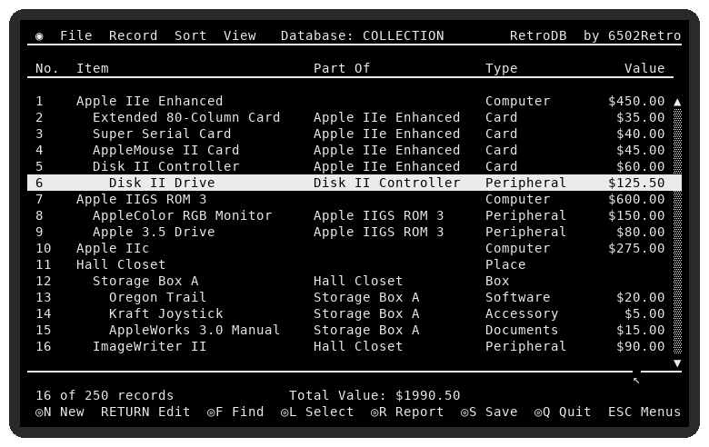

# RetroDB 1.2

Apple IIe, IIc, IIgs Database Software: a forms database for the enhanced
Apple IIe, IIc and IIgs, by 6502Retro.

**Download:** [RETRODB-1.2.po](release/RETRODB-1.2.po) (140K ProDOS disk) ·
[Owner's Manual (PDF)](docs/RetroDB%20Owner's%20Manual.pdf)

RetroDB keeps any list you can describe with a form, in the spirit of
PFS:File (1982), with the look and feel of Mouse Calc and RetroInv:
80-column MouseText screens, pull-down menus, mouse or keyboard, and
ODS and CSV import and export for today's spreadsheets.

- Design a form of up to 16 fields: Text (1-56), Number, Money, Date, Yes/No,
  No. and Part Of
- Records inside records, to any depth (1.1): a No. field numbers every
  record for good, and a Part Of field says which record this one is in;
  Sort > By Part Of shows the list as an indented tree
- Up to 250 records on a 128K Apple (kept in auxiliary memory)
- Change the form at any time; existing records are converted
- Find, Select Records (contains, =exact, <, >, a..b ranges, /not, blank)
- Sort by any field (again to reverse)
- Report: group by one field, count and total another, with average,
  highest and lowest
- Several databases per folder: New, Open, Save, Save As, Revert to Saved,
  safe saving through a temporary file
- Export the list as an ODS spreadsheet (LibreOffice, Excel, Google Sheets,
  with dollar amounts and dates typed) or as CSV (1.2)
- Import ODS or CSV by matching row-1 headings to fields, or make a new
  database from a spreadsheet, guessing each column's type (1.2). The Apple
  unpacks the ODS file's Deflate data itself, through a 32K window in
  auxiliary memory; CSV can use commas, semicolons or tabs

RetroDB contains no code from PFS:File; that program was only a model for
what a forms database does. Its first version was called MouseDB, and it
still opens databases MouseDB saved.

## Running it

Boot `release/RETRODB-1.2.po` (a 140K ProDOS disk) on an enhanced IIe with
an 80-column card, a IIc or a IIgs, or in an emulator. ProDOS starts
RETRODB.SYSTEM. Three sample databases (ADDRESSES, COLLECTION, SOFTWARE)
and COLLECTION exported as COLLECT.ODS and COLLECT.CSV are on the disk.
Keep RETRODB.OVL (the import and export code) next to RETRODB.SYSTEM.

The [Owner's Manual](docs/RetroDB%20Owner's%20Manual.pdf) explains everything.

## Building

Needs cc65 (ca65/ld65), Python 3 with Pillow, and py65 for the tests;
the ODS tests also use LibreOffice (soffice) to check files both ways.

    ./build.sh                 # build/RETRODB.SYSTEM and build/RETRODB.OVL
    python3 tools/mkrelease.py # release/RETRODB-1.2.po
    for t in test/t*.py; do python3 $t; done
    python3 tools/shots.py     # screenshots for the manual

The tests run RetroDB in a 6502 simulator (tools/sim.py) with ProDOS MLI
calls, auxiliary memory and /RAM emulated. Memory starts full of junk, as
on a real Apple (set SIM_GARBAGE=0 for zeros). tools/manual/build.py makes
the PDF manual from tools/manual/manual.md.

## Changes

- **1.2** Export and import ODS and CSV in place of Mouse Calc sheets;
  the new code is loaded from RETRODB.OVL when used.
- **1.1** Records inside records (No. and Part Of fields); renamed from
  MouseDB; Design Form fix for uncleared memory.

## Layout

    src/        6502 source (ca65)
    tools/      build, disk image, simulator, splash and sample makers
    test/       simulator tests
    prodos/     ProDOS 8 2.4.3 and BASIC.SYSTEM (see NOTICE)
    art/        the 6502 Retro Computing logo used on the title screen
    manual/     screenshots
    docs/       the Owner's Manual (PDF)
    release/    the disk image

MIT License; see LICENSE and NOTICE.
